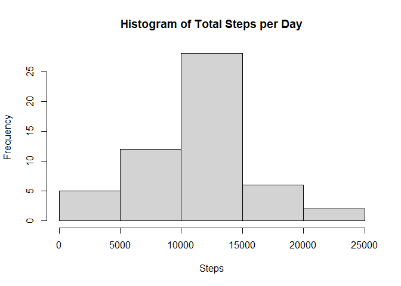
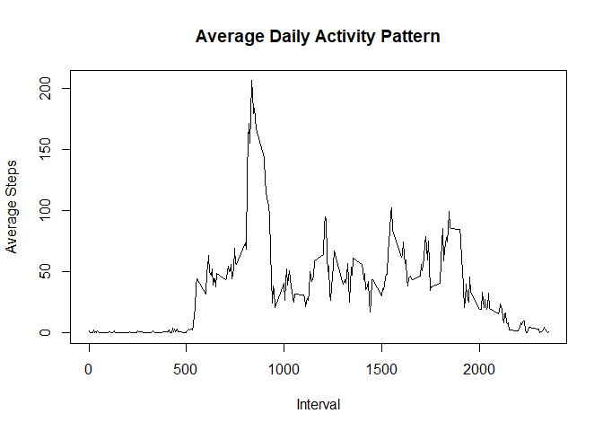
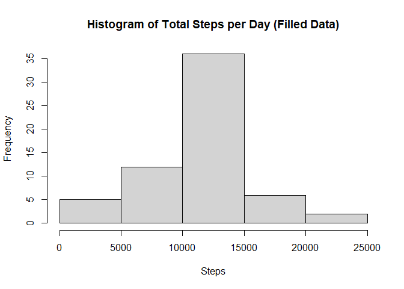
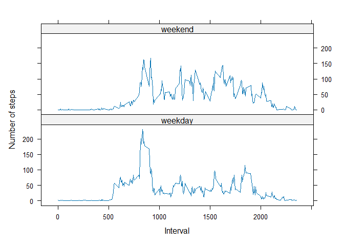

This analysis examines the daily activity patterns using step-count data collected at five-minute intervals. The dataset is processed and analysed to investigate daily activity pattern, missing observations, and differences between weekdays and weekends. 

## Loading and preprocessing the data
First, data was loaded and the class of each column was checked.

``` r
data <- read.csv("activity.csv")
str(data)
```

```
## 'data.frame':	17568 obs. of  3 variables:
##  $ steps   : int  NA NA NA NA NA NA NA NA NA NA ...
##  $ date    : chr  "2012-10-01" "2012-10-01" "2012-10-01" "2012-10-01" ...
##  $ interval: int  0 5 10 15 20 25 30 35 40 45 ...
```

The data was not at its desired class. Therefore, the first column (steps) was changed to class numeric and the second column (date) was changed to class Date.

``` r
data$steps <- as.numeric(data$steps)
data$date <- as.Date(data$date)
```

## What is the mean total number of steps taken per day?
To calculate the mean total number of steps taken per day, first the total number of steps taken per day was identified.

``` r
library(dplyr)
steps_per_day <- aggregate(data$steps, list(date = data$date), sum)
steps_per_day <- rename(steps_per_day, steps = x)
```

Then, using the steps_per_day data frame, a histogram of the total number of steps taken each day was plotted.

``` r
hist(steps_per_day$steps, xlab = "Steps", 
     main = "Histogram of Total Steps per Day")
```

<!-- -->
The histogram illustrated the distribution of total daily step counts across the observation period. Most days fall within 10000 - 15000 steps.

Hence, the mean and median of total number of steps taken each day were calculated.

``` r
mean(steps_per_day$steps, na.rm = TRUE)
```

```
## [1] 10766.19
```

``` r
median(steps_per_day$steps, na.rm = TRUE)
```

```
## [1] 10765
```
The results showed that the mean and median number of steps taken each day was very closed to each other.

## What is the average daily activity pattern?
Next, the average daily activity pattern was investigated. First, the average steps taken for each 5 minutes time interval was calculated. 

``` r
intervals <- aggregate(data$steps, list(interval = data$interval), mean, na.rm = TRUE)
intervals <- rename(intervals, average_steps = x)
```

Using the intervals data frame, a time series plot was plotted to visualise the average daily activity pattern

``` r
plot(intervals$interval, intervals$average_steps, type = 'l',
     xlab = "Interval", ylab = "Average Steps",
     main = "Average Daily Activity Pattern")
```

<!-- -->

Then, the time interval that has the maximum average number of steps was identified.

``` r
intervals[which.max(intervals$average_steps), ]
```

```
##     interval average_steps
## 104      835      206.1698
```

## Imputing missing values
Note that there were some missing values in the dataset that can introduce some bias to the data. First, let's viewed how many rows that contained missing values (NAs)

``` r
sum(is.na(data$steps))
```

```
## [1] 2304
```

To fill in these missing values, the average steps for each intervals were used.

``` r
data_filled <- data
missing_values <- is.na(data$steps)
data_filled$steps[missing_values] <- intervals$average_steps[
  match(data_filled$interval[missing_values], intervals$interval)]
```

Then, histogram is plotted using this filled data to evaluate whether these values differ from the first histogram.

``` r
steps_per_day_filled <- aggregate(data_filled$steps, list(date = data_filled$date), sum)
steps_per_day_filled <- rename(steps_per_day_filled, steps = x)
hist(steps_per_day_filled$steps, xlab = "Steps", 
     main = "Histogram of Total Steps per Day (Filled Data)")
```

<!-- -->

The mean and median were also calculated.

``` r
mean(steps_per_day_filled$steps, na.rm = TRUE)
```

```
## [1] 10766.19
```

``` r
median(steps_per_day_filled$steps, na.rm = TRUE)
```

```
## [1] 10766.19
```

After filling in the missing value, the mean and median had became exactly the same.

## Are there differences in activity patterns between weekdays and weekends?
First, a new factor variable: weekday and weekend was first added to the data.

``` r
data_filled$day_type <- factor(
  ifelse(weekdays(data_filled$date) %in% c("Saturday", "Sunday"),
         "weekend", "weekday"),
  levels = c("weekday", "weekend")
)
```

Then, the average steps for each intervals and each day type (weekday or weekend) was calculated.

``` r
average_steps_daytype <- aggregate(
  steps ~ interval + day_type,
  data = data_filled,
  FUN = mean
)
```

Using the lattice plotting system, the time series plot was plotted for the average steps taken per intervals for both day types.

``` r
library(lattice)
xyplot(
  steps~interval | day_type,
  data = average_steps_daytype,
  type = 'l',
  layout = c(1,2),
  xlab = "Interval",
  ylab = "Number of steps",
)
```

<!-- -->

When comparing the time series plot, the number of steps was higher from approximately 0800 to 1000 during the weekdays, while for the rest of the time, the number of steps were generally higher during the weekend.
